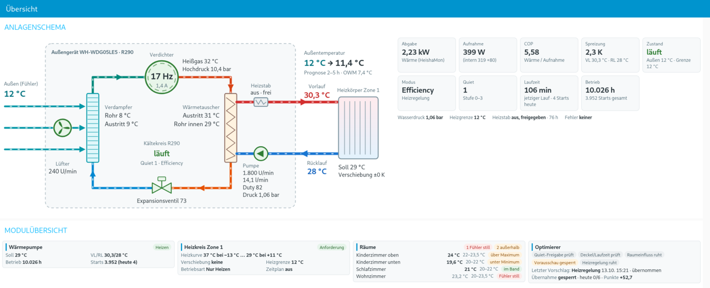
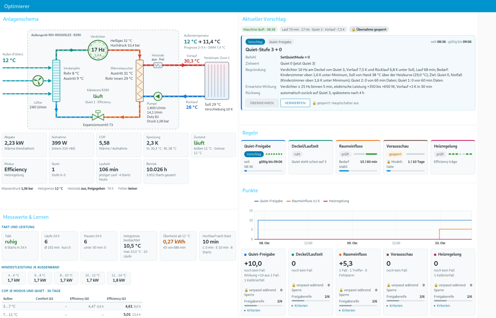

# HeishaMoNR-Ableger: Dashboard und Optimierer für eine Panasonic Aquarea L

Dieses Repository ist ein Ableger von [Egyras/HeishaMoNR](https://github.com/Egyras/HeishaMoNR), dem Node-RED-Flow für Panasonic-Wärmepumpen über [HeishaMon](https://github.com/Egyras/HeishaMon). Der Flow des Originals (Stand 26.5.1 stable) ist die Basis. Darauf sitzen ein deutsches Dashboard, eine eigene Beobachtungs- und Entscheidungsschicht („Optimierer“) und eine Reihe von Werkzeugen zum Messen, Simulieren und Prüfen. Alles ist für eine einzige, konkrete Anlage gebaut und an ihr gemessen. Eine Rückführung in das Hauptprojekt ist nicht geplant.

Die Anleitung des Originals (Installation, Konfiguration, Funktionen wie CCC, RTC, SoftStart) liegt unverändert in [readme_heishamonr_original.md](readme_heishamonr_original.md) und im Ordner [documentation/](documentation/).

Kurz gesagt: Der Optimierer rechnet jede Minute aus, was er an der Wärmepumpe schalten *würde*, schreibt das mit Begründung auf und bewertet seine eigenen Vorschläge später automatisch mit Punkten. Er sendet nie von sich aus. Ein Befehl geht nur hinaus, wenn der Betreiber im Dashboard auf „Übernehmen“ klickt, und auch dann nur nach einer langen Prüfkette.

## Anlage und Umfeld

Die Anlage ist eine Panasonic Aquarea L („Leisha“), Außengerät WH-WDG05LE5: 5-kW-Monoblock mit R290, nur Heizen, eine Zone mit Heizkörpern, kein Warmwasser über die Wärmepumpe, kein Puffer, interner Heizstab, externer Außenfühler. Die Heizkurve läuft mit einer Vorlauf-Untergrenze von 29 °C, die der Betreiber vorgibt.

Das Umfeld:

- HeishaMon an der Wärmepumpe, MQTT-Broker und Node-RED als Docker-Container auf einer NAS.
- Vier Räume mit Shelly H&T Gen3 (melden nur bei Änderung um 0,5 K) und je einem eigenen Komfortband.
- Ein Kinderzimmer mit eigenem Radiator-Relais und Heizlüfter, gesteuert im Flow.
- Energiedaten von Victron Venus/VRM (PV, Akku, Netz) und evcc, Wetter und Vorhersage von OpenWeatherMap.

Wichtig für die Bewertung: Der Netzbezug liegt bei 0,05–0,25 kWh am Tag, eingespeist werden 1,6–66 kWh. Ein Strompreis- oder Tarifmodell bringt hier nichts, die Grenzkosten sind flach. Maßstab ist deshalb der elektrische Energiebedarf für die gebrauchte Wärme bei gehaltenem Raumkomfort.

## Dashboard

Das Dashboard ist auf Deutsch und hat elf Seiten: Übersicht, Einstellungen, Heizung, Betrieb, Zeitplan, Auswertung, Effizienz, Optimierung, Optimierer, Daten & Güte und SYSTEM. Warmwasser, Kühlen, Zone 2 und Solar sind ausgeblendet, nicht gelöscht. Aus 16 sichtbaren Seiten wurden durch Zusammenlegen elf, damit bei 1920 px keine Seite deutlich über etwa 1400 px hoch wird. Ausgelegt ist alles nur für den Desktop (1024 bis 2560 px). Alle Karten der Optimierer-Seiten sind gleich breit (17 Einheiten), weil gemischte Breiten im Masonry-Layout des Dashboards übereinander rutschen.

Das **Anlagenschema** zeigt den Kältekreis der Leisha als SVG mit Live-Werten: Verdichter (Hz, Strom), Lüfter, Verdampfer, Expansionsventil, Wärmetauscher, Pumpe, Heizstab, Heizkörper, Vor- und Rücklauf. Daneben stehen Kennzahlen wie Wärmeabgabe, Aufnahme, COP, Spreizung und Laufzeit. Das Schema steht auf der Übersicht und auf der Seite „Optimierer“ ([tools/schema_ui.js](tools/schema_ui.js)).

Die **Modulkacheln** unter dem Schema (Wärmepumpe, Heizkreis Zone 1, Räume, Optimierer) und die Kopfzeile mit der „modifizierten Außentemperatur“ (Fühlerwert, daneben der Wert, den die Vorhersage der nächsten 2–5 h nahelegt) sind nach dem Vorbild der Reglerschulung von Lambda Wärmepumpen gebaut. Sie liegen auf dem Branch `ui-lambda` und sind noch nicht in `main`.



Die Seite **Optimierer** hat fünf Karten: Aktueller Vorschlag, Regeln, Punkte, Messwerte & Lernen und Entscheidungen. Ein Vorschlag zeigt offen den Befehl, den Zielwert, die Begründung in Zahlen, die erwartete Wirkung und den Rückweg. Der Knopf „Übernehmen“ ist grau und nennt den Grund, solange ihn eine Stufe der Prüfkette sperrt.



Die übrigen Optimierer-Seiten zeigen Verläufe und Raumlage (Optimierung), eine Bedarfs- und COP-Vorschau für 24 h („Wärmefahrplan (Vorschau)“, ohne Empfehlungen) sowie den Zustand aller Datenquellen (Daten & Güte).

## Der Optimierer

### Prinzip

Regler wie der von Lambda arbeiten mit einer modifizierten Außentemperatur aus Historie und Wettervorhersage, beziehen die Räume ein und begrenzen die Leistung. Die Panasonic kennt so etwas nicht. Sie bietet nur grobe Hebel: die Verschiebung der Heizkurve in ganzen Grad, die Quiet-Stufe 0–3 als harten Leistungsdeckel und die Heizregelung Comfort/Efficiency. Der Optimierer bildet die drei Ideen mit genau diesen Hebeln nach:

- **Außentemperatur-Vorausschau:** Die Vorhersage geht als Bedarfsänderung in die Regel „Vorausschau“ ein, bereinigt um den gewöhnlichen Tagesgang.
- **Raumeinfluss:** Die Räume verschieben die Heizkurve um höchstens ±1 K.
- **Leistungsdeckel:** Quiet-Stufe und Heizregelung geben Leistung frei, wenn Bedarf besteht, und deckeln sie, wenn keiner besteht.

Dabei gelten die gemessenen Eigenheiten der Anlage: Der Soll ändert sich nur ganzzahlig im 5-Minuten-Raster, die Anlage stoppt bei Vorlauf = Soll +3,0 bis +3,25 K und startet bei etwa Soll −3,25 K mit rund 9 min Verzug. Jede Regel muss das berücksichtigen, sonst erzeugt sie Takte.

Technisch besteht der Optimierer aus Knoten mit dem Präfix `opt_*` im Tab „WP Optimizer“. Sie werden vollständig vom Generator [tools/optimizer_phase1.py](tools/optimizer_phase1.py) erzeugt. Herzstück ist die Entscheidungsmaschine [tools/engine_core.js](tools/engine_core.js): reine Funktionen ohne Speicher, Dateien, MQTT oder Uhr. Die Zeit kommt immer aus der Eingabe, deshalb lässt sich jede protokollierte Minute exakt nachspielen. Jede Auswertung wird ein unveränderlicher Datensatz in `decisions-YYYY-MM.jsonl` (etwa 2,5–2,7 MB am Tag), auch „nichts tun“.

### Die fünf Regeln

**Quiet-Freigabe (v3).** Hält der Quiet-Deckel den Verdichter fest, obwohl echter Bedarf besteht, schlägt die Regel eine niedrigere Stufe vor. Bedarf heißt: ein Raum liegt unter seinem Minimum oder fällt darauf zu, der Heizstab droht, es ist ein Boost von Hand oder ein Rückstand nach dem Abtauen. Ein Vorlauf unter Soll allein reicht nicht, weil jeder Kaltstart Rückstand hat. Sie gibt nur so weit frei wie nötig und kehrt automatisch zur Ausgangsstufe zurück, sobald der Bedarf 15 min gedeckt ist.

**Deckel/Laufzeit (v5).** Läuft der Verdichter ohne Bedarf mit 28 Hz oder mehr, schlägt die Regel eine höhere Quiet-Stufe vor, wenn die Daten dort einen höchstens 10 % schlechteren COP zeigen. Bei belegtem Takten greift sie schon ab 22 Hz und hat als zweiten Hebel +1 K an der Heizkurve, um Läufe zu verlängern. Ein echtes Takten kam in den bisherigen Daten nicht vor, dieser Hebel ist bisher nur in der Simulation geprüft.

**Raumeinfluss ±1 K (v3).** Die Regel entscheidet direkt aus den Räumen: +1 K, wenn ein Raum mindestens 0,2 K unter seinem Minimum liegt und sich nicht erholt; −1 K, wenn alle Räume mit Reserve über dem Minimum liegen und das Haus überheizt ist. −1 K kommt im Lauf nur bei Vorlauf ≤ Soll, sonst in der Pause, damit die Absenkung keinen Stopp auslöst. Liegt ein Raum über dem Maximum und ein anderer unter dem Minimum, verschiebt sie nichts und meldet stattdessen ein Problem der Wärmeverteilung.

**Vorausschau −1 K (v2).** Sagt das Wetter eine Milderung voraus, die um mindestens 2 K bereinigten Bedarf spart, und haben alle Räume Luft, schlägt die Regel eine Absenkung vor. Sie ist gesperrt, bis das Gebäudemodell sein Gate passiert (mindestens 10 Lerntage, Fehler mindestens 10 % kleiner als der bisherige Schätzer). Den früheren Zweig +1 K gibt es nicht mehr: Die Anlage führt die Kurve selbst alle 5 min nach, und bei Kälte waren die Räume ohnehin überheizt.

**Heizregelung Comfort/Efficiency (v1).** Ziel ist Efficiency. Comfort schlägt die Regel nur bei echtem Bedarf vor, solange Efficiency träge ist (bis Laufminute 45, nach dem Abtauen, bei Heizstab-Nähe) und der Quiet-Deckel den Hochlauf zulässt; sonst kommt zuerst die Quiet-Freigabe. Zurück nach Efficiency geht es nur in der Pause, weil ein Wechsel im Lauf die Pumpe springen lässt. Ein COP-Veto verhindert den Vorschlag nach Efficiency, wenn die Daten Efficiency mehr als 10 % schlechter zeigen als Comfort.

Eine sechste Regel, der Hinweis „Heizgrenze 12 → 10 °C“, ist stillgelegt: Er verlagerte Wärme aus den Stunden mit dem besten COP in kältere. Neben den Regeln laufen reine Wächter ohne Befehl: Wärmeverteilung, Kurvenform („Heizkurve kaltseitig senken“), „Dornröschenschlaf“ (stundenlange Pause trotz erreichter Startschwelle) und ein Störungs-Wächter für Fehlercodes wie H23.

Alle Regeln, Schwellen und deren Herkunft stehen als Daten in der Maschine. Die Tabellen in [docs/OPTIMIERER.md](docs/OPTIMIERER.md) werden aus dem Regelwerk erzeugt, und ein Test prüft, dass sie aktuell sind.

### Sperren und Arbitrierung

Jede Regel erbt eine Liste von Sperren, jede mit Herkunft: Anlaufphase nach Neustart, veraltete HeishaMon-Daten, Fehlercode, MQTT-Notbremse von HeishaMoNR, Abtauen, Laufbeginn, Heizgrenze-Aus, konkurrierender Regler, Takt-Gefahr, Heizstab-Nähe, Frequenzsprung bei Abtauwetter, Tageslimit und Wartezeiten.

Je Stellgröße hat zu jeder Zeit höchstens eine Regel das Sagen. Zwischen zwei Leistungsänderungen (Quiet, Verschiebung, Heizregelung) liegen mindestens 60 min, damit sich eine Wirkung zuordnen lässt. Die Gegenrichtung ist frühestens nach 60 min erlaubt, ohne Notfall erst nach 240 min. Ein Notfall (Raum mindestens 0,3 K unter Minimum oder Heizstab-Nähe) verkürzt manche Fristen auf 10 min.

### Bewertung mit Punkten

Der Betreiber vergibt keine Punkte, auch „Verwerfen“ ist keine Bewertung. Jeder Vorschlag ist ein Fall mit einer vorab festgelegten Prognose („ohne Freigabe bleibt der Verdichter am Deckel“, Wahrscheinlichkeit p, Horizonte z. B. 30/60/120 min). Am Horizont wird gemessen, ob das Problem bestand. Die Punkte folgen dem Brier-Prinzip gegen eine gelernte Basisrate b („bleibt, wie es ist“):

```
Punkte je Horizont = 100 × [(b − o)² − (p − o)²] / Anzahl Horizonte
```

Liegt b mindestens bei p, zählt ein Treffer neutral, ein Fehlalarm aber voll (Bewertungsregeln v5). Dazu kommen Abzüge für Schaden (Heizstab lief, Stopp binnen 10 min, Überschwingen, zu warm, zu kalt) und für verpasste Lagen. Eine Wirkungsprognose zählt nur, wenn die Änderung wirklich passiert. Wer ohne Trennschärfe vorschlägt, bekommt im Mittel keine positiven Punkte, das prüft die Simulation. Jede Änderung der Bewertungsregeln erhöht deren Version, alte Summen bleiben getrennt stehen. Die „Freigabereife“ einer Regel ist nur eine Anzeige (u. a. mindestens 10 Fälle, 14 Tage, kein Schaden). Die Entscheidung trifft der Betreiber.

### Ein-Klick-Übernahme und ihre Grenzen

Auf der Seite „Optimierer“ gibt es die Knöpfe „Übernehmen“, „Verwerfen“, „Zurücksetzen“ und „Übernahme sperren“. Der Generator liefert den Sendeweg doppelt gesperrt aus: Der eigene `mqtt out` ist deaktiviert, und ohne die Datei `apply.json` mit Hauptschalter und freigegebenen Regeln ist die Übernahme aus. Erst mit dem Schalter `--uebernahme-knoten-aktiv` und dieser Datei kann ein Klick senden. In der eigenen Anlage hat der Betreiber das inzwischen freigegeben. Gesendet wird trotzdem nur nach Klick.

Vom Browser kommen nur ID und Prüfsumme des Vorschlags. Der Server prüft dann unter anderem: Hauptschalter, Alter der Maschine (höchstens 2,5 min), Prüfsumme, Freigabe der Regel, Gültigkeit, Whitelist, Notbremse, frische HeishaMon-Daten, Sperren der Regel und den Ist-Zustand der Anlage. Die Grenzen sind fest im Kern:

- Whitelist: `SetQuietMode` 0–3, `SetZ1HeatRequestTemperature` −1/0/+1 (höchstens 1 K je Befehl), `SetHeatingControl` 0/1. Sonst nichts, auch keine Pumpe.
- Höchstens 6 Befehle am Tag, mindestens 10 min Abstand.
- Rücklesen über HeishaMon binnen 90 s, höchstens 2 Wiederholungen, danach eine rote Warnung.
- Jede Übernahme hat einen Rückweg auf den Ausgangswert mit Frist. Rechnet die Maschine 30 min lang nicht, geht jede Übernahme zurück.
- „Übernahme sperren“ schaltet ab. Entsperren geht nie über das Dashboard, nur über die Datei.
- Jede Aktion, auch jede Ablehnung, steht in `applied-YYYY-MM.jsonl`.

## Messungen und Befunde zur Leisha

Die Regeln stützen sich auf Messungen an dieser Anlage seit dem 07.10.2026, ergänzt um eine Auswertung des Photovoltaikforum-Threads 189605 (Aquarea-Serien, jede Aussage im Originalbeitrag nachgelesen). Die wichtigsten Befunde:

| Thema | Befund |
|---|---|
| Stopp | bei Vorlauf = angezeigter Soll +3,00 bis +3,25 K (20 von 20 Fällen) |
| Start | bei etwa Soll −3,25 K, rund 9 min Verzug. Die Forum-Regel „Vorlauf unter Rücklauf beim Abschalten −3 K“ trifft hier im Mittel 24,6 min zu früh |
| Heizgrenze 12 °C | aus bei 15 °C, wieder an bei 12 °C |
| Quiet-Deckel | Q3 16–17 Hz; Q2 17 Hz bei 12 °C und 20–21 Hz bei 1–2 °C; Q1 21 Hz bei 12 °C; Q0 30–35 Hz |
| Comfort/Efficiency | Comfort fährt nach dem Start sofort auf 30–35 Hz. Efficiency bleibt bei 16–17 Hz und geht erst ab Laufminute 39–46 zeitweise auf 21–26 Hz. Ein Wechsel im Lauf lässt die Pumpe von 1750 auf 2850–2900 U/min springen |
| Takten | 07.–13.10. nicht beobachtet: 1–7 Starts am Tag, Läufe bis zum Stopp 96–969 min |
| Mindestfrequenz (Forum) | bei der L5 16 Hz, ab −4 °C 25 Hz, ab −10 °C 35 Hz, unabhängig vom Quiet-Modus |
| Abtauen (Forum) | Efficiency hält nach dem Abtauen etwa 20 min niedrig; ein Frequenzsprung nach langem Niedriglauf kann Pseudo-Abtauungen auslösen |

**COP-Korrektur.** Der interne Stromwert der Anlage (TOP16) untertreibt im Lauf: Forumsmessungen an der L5 mit einem Shelly zeigen 70–90 W zu wenig. Der Optimierer addiert deshalb bei laufendem Verdichter eine Konstante von 80 W. Das ist eine Annahme im belegten Bereich, sie lässt sich in `config.json` ändern. Gespeichert wird roh, korrigiert wird beim Lesen. So bleiben alle Zähler mit jeder Konstante neu rechenbar. Für die Woche 07.–13.10. ändert das die COP-Bänder deutlich:

| Außen | COP roh | COP korrigiert |
|---|---|---|
| < 4 °C | 5,13 | 4,30 |
| 4–8 °C | 5,57 | 4,62 |
| 8–11 °C | 6,07 | 4,92 |
| ≥ 11 °C | 6,82 | 5,51 |

Eine Folge: Der früher gemessene COP-Vorteil von 16–17 Hz gegenüber 22–27 Hz verschwindet mit der Korrektur im Rauschen. Deshalb deckelt die Regel „Deckel/Laufzeit“ ohne Takt erst ab 28 Hz. Die Korrektur des HeishaMoNR-Kerns selbst (COP-Anzeige, kWh-Zähler, Weitergabe an Venus/VRM) liegt als eigener Patch auf dem Branch `kern-cop-korrektur`.

Die Messungen und Herleitungen stehen in [docs/OPTIMIERER.md](docs/OPTIMIERER.md) (Abschnitte 7, 12, 17–21) und [docs/heating_control_concept.md](docs/heating_control_concept.md). Was die Maschine auf den echten Daten der ersten Tage getan hätte, zeigt [docs/replay_2026-10-07_bis_10.md](docs/replay_2026-10-07_bis_10.md).

## Bonsai-Beobachter

[tools/bonsai_beobachter.py](tools/bonsai_beobachter.py) begleitet den Optimierer täglich, nur beratend und nie im Regelkreis. Er liest die Protokolle nur lesend und rechnet die Tageszusammenfassung selbst und deterministisch: Läufe, Pausen, Energie und COP, Raumverläufe gegen die Bänder, Entscheidungen, Punkte, Datenqualität. Daraus entstehen geprüfte Befunde. Ein lokales Sprachmodell („Bonsai“, über einen OpenAI-kompatiblen Server) beantwortet danach nur drei kurze Fragen zu Auffälligkeiten, zum Vergleich mit dem Vortag und zur Datenqualität. Jede seiner Aussagen muss Fakten-Schlüssel als Beleg nennen und darf nur Zahlen aus diesen Fakten enthalten, sonst wird sie verworfen. Was übrig bleibt, steht als „ungeprüft“ im Bericht und nie als Warnung. Der Beobachter braucht nur die Python-Standardbibliothek und schreibt nie an Anlage, NAS oder MQTT.

## Arbeitsweise

**Nur `opt_*` über den Generator.** Der Generator ist idempotent: Er ersetzt die Knoten, die ihm gehören, und lässt alles andere unberührt. Zugangsdaten (OpenWeatherMap, VRM) liegen nur in Dateien im Container, nie im Flow oder im Repository.

**Erst simulieren, dann einspielen.** Steuerlogik wird nie live ausprobiert. Die Simulationen spielen den Flow offline mit einer Fake-Uhr über mehrere Tage durch, auch mit Frost, Abtauen und Heizstab, im Schattenbetrieb und mit „jeder Vorschlag sofort übernommen“. Das Replay spielt die echten Protokolle Minute für Minute durch die Maschine. Ein zweiter Lauf ist bit-identisch. Vor jeder Regeländerung wird alt gegen neu verglichen.

```
cp "flows (26.5.1 stable).json" /tmp/x.json
python3 tools/optimizer_phase1.py /tmp/x.json      # opt_* erzeugen (Sendeknoten deaktiviert)
node tools/optimizer_sim.js /tmp/x.json            # Flow-Prüfungen
node tools/engine_sim.js /tmp/x.json [Datenordner]  # Maschine, Fake-Uhr, Replay-Prüfungen
node tools/engine_replay.js <Datenordner> --md     # Replay der echten Protokolle
```

**Vorschau bei 1024, 1920 und 2560 px.** [tools/opt_seiten_vorschau.js](tools/opt_seiten_vorschau.js) und [tools/engine_ui_preview.js](tools/engine_ui_preview.js) bauen die Seiten aus den echten Vorlagen nach. [tools/ui_vorschau_pruefen.js](tools/ui_vorschau_pruefen.js) öffnet sie offline in Firefox headless, schreibt je Breite ein PNG und meldet inneres Scrollen, abgeschnittene Elemente, waagrechtes Scrollen und Überlappungen. Die Bilder oben stammen aus dieser Vorschau.

**Kern-Patches idempotent und rückbaubar.** Änderungen an den Knoten des Originals laufen nie über den Generator, sondern über eigene Skripte (`tools/*_patch.py`, `tools/cop_idle_fix.py`). Jede Änderung steht dort mit erwartetem Altwert in einer Whitelist. Weicht die Datei ab, bricht das Skript ab, statt still zu überspringen. Es gibt `--dry-run`, `--apply` mit Sicherung und `--revert`, der byte-gleich zurückbaut. Zu den Skripten gibt es eigene Tests.

**Einspielen.** Eingespielt wird gegen einen frischen Export des laufenden Flows, als Deploy vom Typ `nodes` mit Prüfung der Revision, nach einer Sicherung des Flows. Danach werden die Seiten live in den drei Breiten angesehen.

## Aufbau des Repositorys

| Pfad | Inhalt |
|---|---|
| `flows (26.5.1 stable).json` | Node-RED-Flow: Kern des Originals plus eigene Änderungen und `opt_*`-Knoten |
| [tools/optimizer_phase1.py](tools/optimizer_phase1.py) | Generator für alle `opt_*`-Knoten, Vorlagen und eingebetteten Funktionen |
| [tools/engine_core.js](tools/engine_core.js) | Entscheidungsmaschine: Regeln, Sperren, Punkte, Übernahme (reine Funktionen) |
| `tools/engine_view.js`, `tools/eng_ui.js` | Daten und Darstellung der Seite „Optimierer“ |
| `tools/schema_ui.js`, `tools/ui_chart.js`, `tools/ui_optik.css` | Anlagenschema, SVG-Diagramme, gemeinsamer Stil |
| `tools/*_sim.js`, `tools/*_test.py`, `tools/*_test.js` | Simulationen mit Fake-Uhr und Tests |
| `tools/engine_replay.js`, `tools/*_analyse.js`, `tools/cycle_analysis.py`, `tools/switch_events.py` | Replay und Auswertungen der Protokolle |
| `tools/*_patch.py`, `tools/cop_idle_fix.py`, `tools/heating_only_de.py`, `tools/heating_control_switch.py` | Änderungen an den Kernseiten und Kernknoten |
| `tools/de/`, `tools/de_extract*.py` | Übersetzung der Dashboard-Texte |
| [tools/bonsai_beobachter.py](tools/bonsai_beobachter.py) | Beobachter mit lokalem Sprachmodell |
| [docs/OPTIMIERER.md](docs/OPTIMIERER.md) | Ausführliche Doku: Regeln, Sperren, Punkte, Übernahme, Tests, Befunde, Änderungsverlauf |
| [docs/heating_control_concept.md](docs/heating_control_concept.md) | Comfort/Efficiency: Konzept und erste Messung |
| [docs/replay_2026-10-07_bis_10.md](docs/replay_2026-10-07_bis_10.md) | Replay der Maschine auf echten Daten |
| `images/ableger/` | Bilder dieser README |
| `documentation/`, `images/dashboard/`, `HomeAssistant/`, `heishamon2influxdb/`, `old_flows/`, `icons/` | Unverändert aus dem Original |

## Branches

`main` enthält den zusammengeführten Stand der Arbeitszweige. Jeder Zweig trägt ein Thema im Namen, etwa `raumeinfluss-v3`, `regel-heizregelung`, `cop-korrektur` oder `review-paket`. Vor dem Zusammenführen laufen Simulation, Replay und Vorschau. Offen und noch nicht in `main` sind derzeit:

- `ui-lambda` und `ui-lambda-2`: Modulkacheln, modifizierte Außentemperatur, Statistik und Trendansicht.
- `kern-cop-korrektur`: COP-Korrektur im HeishaMoNR-Kern (COP-Anzeige, kWh-Zähler, Weitergabe an VRM).
- `delaytest`, `delaytest-v2`: ein vorbereiteter Test der Start- und Stoppverzögerung, nicht aktiv.

## Grenzen

- **Anlagenspezifisch.** Schwellen, Deckel, Start- und Stopplogik sind an dieser einen L5 mit Heizkörpern gemessen. Andere Geräte, Fußbodenheizung, Puffer oder Warmwasser verhalten sich anders. Übertragbar sind die Arbeitsweise (Schattenbetrieb, Bewertung gegen eine Basisrate, Sperren mit Herkunft, Whitelist und Prüfkette, Replay mit Fake-Uhr) und die Werkzeuge. Die Zahlen sind es nicht ohne eigene Messung.
- **Kein Winter gesehen.** Die Daten beginnen am 07.10.2026 und reichen bis etwa 1 °C. Alle Werte zu Frost, Abtauen, Mindestfrequenz unter 0 °C und Heizstab stammen aus dem Forum oder sind Annahmen. Sie sind im Code als `ANNAHME` gekennzeichnet.
- **Messunsicherheit.** Die Wärmeleistung ist Durchfluss × Spreizung, bei 2–3 K Spreizung und 0,25 K Auflösung etwa ±10 % je Wert. Der Strom ist eine Schätzung der Anlage plus 80 W. COP-Unterschiede von wenigen Prozent sind damit Rauschen. Ein eigener Stromzähler für die Wärmepumpe fehlt.
- **Wenig Fälle.** Die Punktesummen beruhen bisher auf wenigen Fällen. Die Freigabereife verlangt mindestens 10 bewertete Fälle über 14 Tage.
- **Zweiter Schreiber.** HeishaMoNR kann eine Verschiebung des Optimierers bei einer eigenen Sollwertänderung überschreiben. Ein vorbereitetes Kern-Paket ([tools/kern_patch.py](tools/kern_patch.py)) ist nicht eingespielt.
- **Keine Garantie.** Das ist ein privates Projekt an einer laufenden Heizung. Wer etwas davon übernimmt, prüft es an der eigenen Anlage und trägt die Verantwortung selbst.

## Herkunft und Lizenz

Grundlage ist [Egyras/HeishaMoNR](https://github.com/Egyras/HeishaMoNR), Version 26.5.1 stable. Dank an Egyras und alle, die an HeishaMon und HeishaMoNR mitgearbeitet haben. Ohne die offene Anbindung der Panasonic-Wärmepumpen gäbe es dieses Projekt nicht. Für Lizenz und Urheberrecht gelten die Angaben des Originals, siehe [readme_heishamonr_original.md](readme_heishamonr_original.md) und [documentation/acknowledgements.md](documentation/acknowledgements.md). Dieser Ableger ändert daran nichts.
